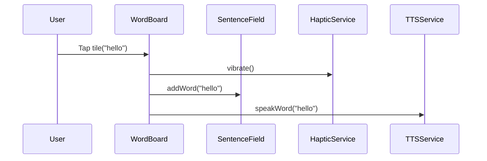

# Feature Spec – Interactive Word Board

## 1. Objective
Enable DHH users to quickly construct sentences by tapping visually rich word tiles. Each tap should provide immediate multimodal feedback (haptic + TTS) and update the sentence field, minimizing cognitive load and interaction time.

## 2. Success Metrics
| Metric | Target |
|--------|--------|
| Median taps-to-word latency (tap → sentence update) | < **100 ms** |
| Median taps-to-TTS start latency | < **150 ms** |
| Time to build & speak a 5-word sentence (board only) | < **15 s** |
| Tile mis-tap rate (undo within 2 s) | < **5 %** |

## 3. Scope (MVP)
* Display and interact with a single deck (`Core Words`).
* Grid layout adapts to phone portrait / landscape and tablet.
* Each tile shows text; optional icon if provided.
* Pagination (swipe or page dots) when items exceed viewport.
* Tap tile ⇒ `addWord()` flow (see §6).
* Long-press tile ⇒ no action (reserved for edit mode in Deck Manager).
* Visual state for word vs. sentence tiles (e.g., color strip or badge).

Out-of-Scope (MVP)
* Tile reorder / drag-and-drop.
* Folder-within-deck hierarchy.
* Dynamic resizing by user.

## 4. User Stories
1. *As Alex*, I see clear tiles with icons so I can find words fast.
2. *As Sam*, when I tap a tile I hear the word spoken instantly.
3. *As Jordan*, I feel a vibration confirming my tap.
4. *As any user*, when tiles overflow, I can swipe pages to reach them.

## 5. Functional Requirements
| ID | Requirement |
|----|-------------|
| WB-1 | Render tiles using deck data source (local DB / JSON). |
| WB-2 | Grid auto-fits **≥ 44 dp** touch target per tile. |
| WB-3 | On tap: append word to sentence field with leading space if needed. |
| WB-4 | Trigger medium intensity haptic feedback (platform default). |
| WB-5 | Play TTS of tapped word (use system voice, inherit current locale). |
| WB-6 | Visually indicate tap (opacity ripple). |
| WB-7 | Prevent double activation within 250 ms (debounce). |
| WB-8 | Persist last page visited per deck. |
| WB-9 | Support both light & dark themes with sufficient contrast. |

## 6. Flow Diagram


## 7. UI / Layout
| Form Factor | Columns | Rows (visible) |
|-------------|---------|----------------|
| Phone Portrait | Auto (min 4) | Auto |
| Phone Landscape | +1 column | +-1 row |
| Tablet | Min 6 | Auto |

Grid logic: use `SliverGridDelegateWithFixedCrossAxisCount` with dynamic count based on width / minTileSize.

## 8. Data Models
```dart
class Deck {
  final String id;
  final String name;
  final List<TileItem> items; // ordered
}

class TileItem {
  final String id;
  final String text;
  final String? iconPath; // asset or network
  final TileType type; // word | sentence
}
```

## 9. Dependencies / Modules
* `WordBoardWidget` – renders grid & manages pagination.
* `SentenceController` – shared state provider (Riverpod/Provider) holding current sentence.
* `TTSService` – wrapper over `flutter_tts` or platform channels.
* `HapticService` – wrapper over `Vibration` / `HapticFeedback`.
* `DeckRepository` – loads deck from local storage (`hive` box `decks`).

## 10. Accessibility & Internationalization
* Announce tile label via screen reader on focus.
* Ensure icons have semantic labels.
* Support larger text sizes (Flutter `MediaQuery.textScaleFactor`).

## 11. Analytics Events
| Event | Properties |
|-------|------------|
| `tile_tap` | `tile_id`, `deck_id`, `word` |
| `page_swipe` | `deck_id`, `page_index` |
| `tts_play_start` | `latency_ms`, `word` |

## 12. Acceptance Criteria (Gherkin)
```
Scenario: Tapping a word tile
  Given the Word Board is visible
  When the user taps the "hello" tile
  Then "hello" is appended to the sentence field
  And the device vibrates once
  And "hello" is spoken aloud within 150 ms
```

## 13. Open Questions
1. Should sentence tiles also *immediately* speak the full sentence or behave like words?
2. Minimum device width to support two-column landscape on small phones?
3. Cache strategy for frequently used word audio – generate & store WAV/OGG or rely on TTS every time? 